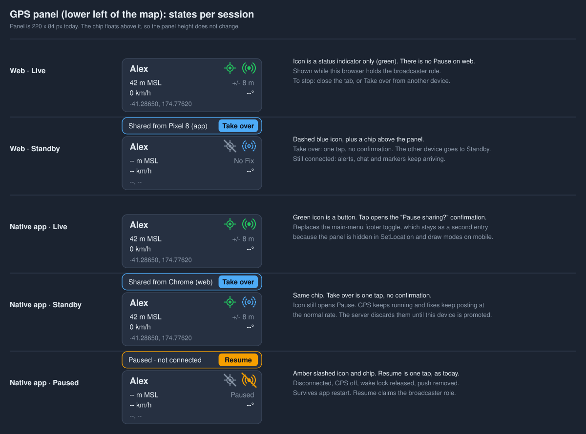
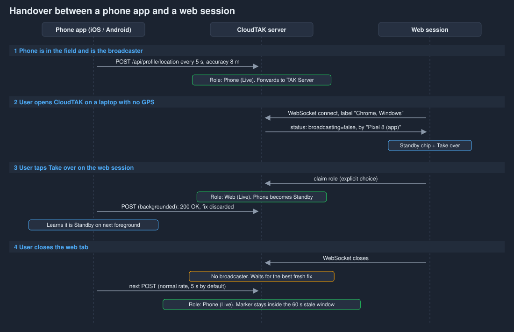
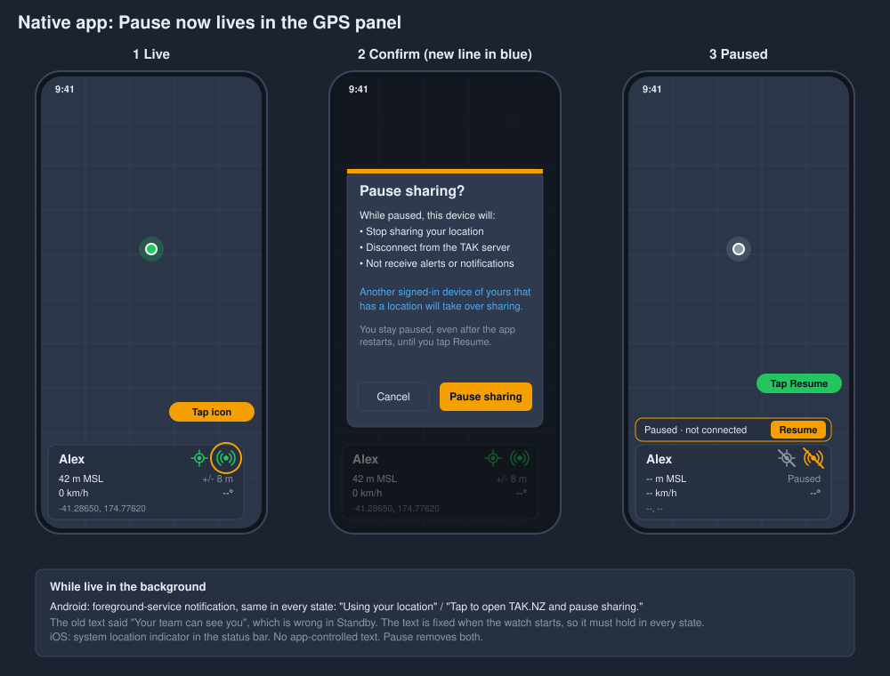

# Multi-session location handover

Status: implemented. `cloudtak.locationArbitration` is `enforce` in both `dev-test` and `prod` in `cdk/cdk.json`.
The application default, with the variable unset, is `observe`. Mockups are in `docs/fork/mockups/`. The rationale
is also summarised in [FORK-DELTA.md](FORK-DELTA.md).

## Mode

`CLOUDTAK_Location_Arbitration` on the stateful service takes one of three values:

- `enforce`: fixes from sessions that are not the broadcaster are dropped, clients are told their state, and the
  broadcaster's position is relayed to the user's other sessions.
- `observe`: the arbiter logs `ok - location - ...` lines showing what it would drop, and nothing changes for users
  except that no session sends 0,0.
- `off`: the kill switch. Set it in `cdk/cdk.json` and redeploy, or set the variable on the task.

The variable only changes with a CDK deploy, because it lives in the task definition. Restarting the stateful
service rebuilds the in-memory state from the next fixes. Once `enforce` has run on prod without surprises, the
mode and the CDK option can be removed so the arbiter always enforces.

## Problem

Every session of a user (browser tab, iOS app, Android app) builds the same self CoT uid,
`ANDROID-CloudTAK-<username>` (`app/src/workers/atlas-profile.ts` `uid()`, `api/common/control/takserver.ts`
`profileUid()`), and each one sends a position about every 5 seconds. A session with no GPS and no
manual location sends 0,0 (`atlas-profile.ts`, `setupTimer()`). With two sessions the marker
alternates between their positions.

Native apps send position in two ways: the JS worker over the WebSocket while the WebView runs, and
the native plugin POSTing `/api/profile/location` (`stores/map.ts` `startLocationWatch`). The POST is the only
path that works while iOS suspends the WebView.

## Approach: one broadcaster per user, explicit states per session

One marker per user, one uid, one TAK Server connection. Chat, missions and packages are unchanged.

| State | Set by | Connected, receives alerts | Sends position to TAK | Survives restart |
|---|---|---|---|---|
| Live | server rules or user | yes | yes | no |
| Standby | server | yes | no (fixes are discarded server-side) | no |
| Paused | user, native only (today's Pause) | no | no | yes |

### Who is Live

Evaluated server-side, in one place that both the WebSocket handler and `PUT/POST /profile/location`
(`hub.submitCots`) pass through. Every fix from a session is a claim and carries its accuracy.

1. An explicit choice (Take over, or Resume) wins.
2. A live GPS fix beats a manual location. A session with neither never broadcasts and never sends 0,0.
3. The current broadcaster stays Live while it reports fixes. A session that merely arrives does not take over.
4. A challenger replaces a healthy broadcaster only if its fix is clearly better (for example 8 m against 400 m).
5. If the broadcaster stops reporting for about 3 intervals (at least 15 s), the best remaining fresh Standby
   session is promoted. Closing the WebSocket is deliberately not the trigger: iOS suspends the WebView and drops
   its WebSocket while the native POSTs carry on.

Sessions are identified by the login session id, the `s` claim in the JWT (`AuthUser.session`). It is available on
the WebSocket and on the native POST (Bearer token), and refresh keeps it, so no new header is needed. Two tabs in one
browser share a session, which is correct because they share a device. A session also carries a label
("Pixel 8 (app)", "Chrome (web)") sent at connect time. Tokens without `s` (server-minted) are treated as always allowed.
The relay and the Standby notices use the existing `wsNotify(key, payload, excludeSession)` and `submitCots({ broadcast })`.

## UI

The control lives in the GPS panel, lower left of the map. The panel keeps its 220 x 84 px size.

- A broadcast icon sits next to the existing location icon in the callsign row.
  - Green solid: Live. Blue dashed: Standby. Amber slashed: Paused.
- A chip floats above the panel only in Standby and Paused.
  - Standby: "Shared from <device>" and a **Take over** button.
  - Paused: "Paused, not connected" and a **Resume** button.
- Web: the icon is a status indicator. There is no Pause on web. Closing the tab is the way out.
- Native: the icon is a button. Tapping it while Live opens the existing "Pause sharing?" dialog.
- The main-menu footer toggle (`SharingToggle.vue`) stays as a second entry, because the GPS panel is hidden
  on mobile in SetLocation and draw modes.

## Scenarios

1. **Phone live, laptop opened (no GPS).** The laptop starts in Standby with "Shared from Pixel 8 (app)".
   It never sends 0,0. The marker does not move.
2. **User taps Take over on the laptop.** The laptop becomes Live (manual location if it has one). The phone goes
   to Standby. If the phone is in the background it learns this on the next foreground. Meanwhile its POSTs are
   answered 200 and discarded, so the native layer does not retry or back off.
3. **User closes the laptop tab.** The laptop stops reporting. After about 15 s the server promotes the phone on its
   next POST. The 60 s CoT stale time covers the gap, so the marker does not disappear.
4. **Laptop and phone both have GPS.** The incumbent stays. A new session takes over only with a clearly better
   fix, and the old one shows the Standby chip.
5. **Phone Paused while the laptop is open.** A Paused phone is disconnected and sends nothing, so the laptop
   becomes Live if it has a position source. If it has none, nobody broadcasts and the marker goes stale after 60 s.
   The laptop chip says no device is sharing.
6. **Phone Resumed while the laptop is Live.** Resume counts as an explicit choice. The phone becomes Live and the
   laptop goes to Standby.
7. **Two sessions legitimately in different places.** Only one position reaches the map. Showing both needs
   per-device markers, which is a separate and larger change (chat routing, mission subscriptions and the
   other uses of the self uid).

## Pause on iOS and Android

Pause keeps today's behavior (`stores/sharing.ts`): close the TAK WebSocket, stop the self timer, stop the
location watch, release the wake lock, remove the push token. It is stored per user in Capacitor Preferences and
survives restarts.

Changes:

- The control moves into the GPS panel icon (see above). On native the icon opens the Pause dialog in both Live and Standby.
- The confirmation dialog gains one line: another signed-in device with a location will take over sharing.
- A Paused device is not a candidate for Live, because it is disconnected.
- Resume claims the broadcaster role.
- Standby is separate from Pause. It keeps the connection, push, wake lock and location watch, and is never stored.

Background behavior:

- iOS suspends the WebView. Only the native POST keeps running, so Standby is enforced by the server dropping POSTs,
  and the phone learns its state when it returns to the foreground.
- Android's foreground service keeps the process alive, but the WebView may still be throttled. The same server-side
  rule applies. This is untested.
- The Android notification text ("Your team can see you ... pause") was wrong in Standby. It now reads
  "Using your location" / "Tap to open TAK.NZ and pause sharing.", which holds in every state and avoids
  restarting the watch on a state change.

## Decisions on the earlier open points

- **Standby POST rate.** Dropped. The native POST cannot read the server's answer, and the plugin fixes `minIntervalMs`
  when the watch starts. A backgrounded iOS app cannot be told to slow down. On iOS `minIntervalMs` only throttles the
  POST; GPS stays at best accuracy with no distance filter. On Android it also sets the GPS request interval. Standby
  phones keep posting at the normal rate and the server discards the fixes. Failover latency is one POST interval.
  Revisit only if battery complaints appear, then restart the watch with a slower interval on Android when the app
  returns to the foreground.
- **Android WebSocket in the background.** Not a blocker. The design never relies on it. Test once on a device
  (10 minutes backgrounded, then Doze) and record the result.
- **Standby session's own marker.** The server relays accepted fixes to the user's other sessions with the existing
  `ConnectionPool.cots()` fan-out, excluding the sender. A Standby session does not write its own position into its
  local self marker. Its GPS puck still shows the device position.
- **Android notification text.** "Using your location" / "Tap to open TAK.NZ and pause sharing." in all states.
  It is a string change at `geolocation.ts` (`backgroundTitle`, `backgroundMessage`) and needs no watch restart.
- **Foreground double sending.** Per session, while worker self CoTs arrive over the WebSocket (richer: battery, takv),
  ignore the POST for that session. When the WebSocket is silent for about 2 intervals, accept the POST.
- **Standby session that never returns to the foreground.** No UI. The broadcaster is always shown on the chips of the
  other sessions. A sessions list is deferred until users ask for it.
