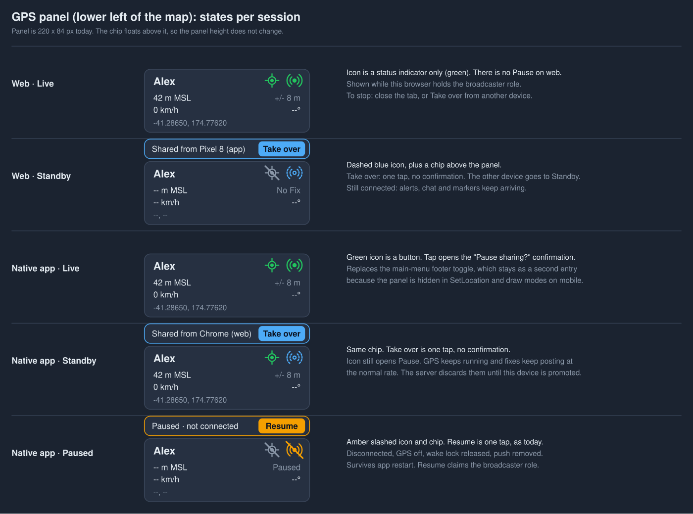
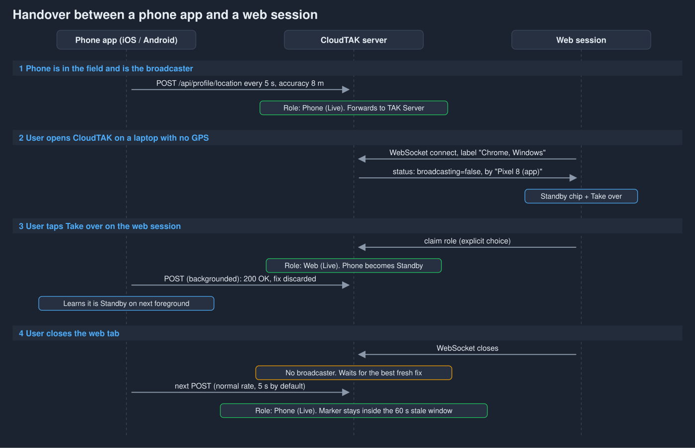
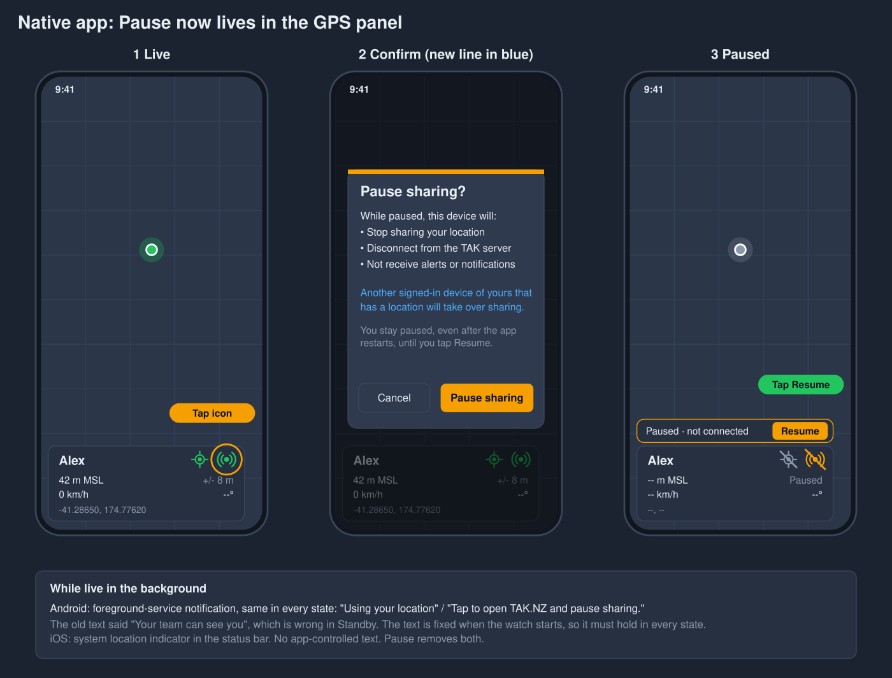

<!--
DRAFT of a feature request for https://github.com/dfpc-coe/CloudTAK/issues/new

Not filed. To file it:
  1. Copy the title below and everything under "Body".
  2. GitHub does not resolve the relative image paths. Drag the three PNGs from
     docs/fork/mockups/ into the issue editor and replace the three  lines
     with the links GitHub generates.
  3. Replace [PR LINK] once the pull request is open.
-->

# Title

Feature request: one location broadcaster per user, so a second session stops moving the skittle (#1883)

# Body

Before sending a patch I would like to ask whether this fits CloudTAK, since it changes what a user's
second session does. Our downstream fork has it working behind an environment flag, and I can adapt it to
whatever you prefer.

Related: #1883 (the same symptom, reported as a bug), #1775 (telling a user's sessions apart) and #2046
(pause sharing in the mobile app).

Observed on v13.124.0. The file paths below are from that tree, and I checked that `main` still has the
behaviour described.

---

## The problem

Every session of a user (each browser tab, the iOS app, the Android app) builds the same self uid,
`ANDROID-CloudTAK-<username>` (`AtlasProfile.uid()` in `app/src/workers/atlas-profile.ts`, and
`profileUid()` in `api/common/control/takserver.ts`), and each one sends a position every `tak_loc_freq`
(5 seconds by default). TAK Server keeps one position per uid, so the last writer wins and the marker
jumps between the sessions. That is #1883.

Three things make it worse than it looks:

- **A session with no position still sends one.** `AtlasProfile.setupTimer()` falls back to `[0, 0]` when
  there is neither a GPS fix nor a manual location. A desktop tab with no GPS and a phone that has one
  fight constantly, and a desktop tab on its own puts the user at 0,0.
- **The native app has a second path.** Because iOS suspends the WebView in the background, the location
  plugin POSTs each fix to `/api/profile/location` itself (`startLocationWatch` in `app/src/stores/map.ts`).
  That route does not go through the WebSocket handler, so a fix in `ConnectionWebSocket` alone would miss it.
- **TAK Server does not echo a CoT back to the connection that sent it.** All of a user's sessions share
  one TAK Server connection, so a second session never sees the position the first one reports.

## Proposal: one broadcaster per user, chosen by the server

Keep the one uid and the one TAK Server connection per user. Chat, mission subscriptions and packages all key
on that uid, so changing it is a much bigger change (see "Alternatives" below). Instead the server picks one
session as the broadcaster, and fixes from the other sessions are dropped before they reach TAK Server.

Sessions are identified by the login session id, the `s` claim in the JWT. It is on the WebSocket and on the
native POST (Bearer token), and token refresh keeps it, so no new header is needed. Two tabs of one browser
share a session, which is right because they share a device.

Rules, in order:

1. An explicit choice wins: **Take over** (or Resume in the mobile app) makes that session the broadcaster
   from its next fix on, and it stays until that session goes quiet or another one takes over.
2. A live GPS fix beats a manual location.
3. The current broadcaster keeps the role while it keeps reporting. A session that merely arrives does not
   take over.
4. A challenger replaces a healthy broadcaster only with a clearly better GPS fix (3 times better and at
   least 50 m better, so two similar fixes do not take turns).
5. A broadcaster that is silent for about 3 reporting intervals (at least 15 s) is replaced by the best
   fresh session. A WebSocket close is deliberately not the trigger, because iOS drops the socket while
   the native POSTs carry on.

It fails open: a fix with no session, a sole session, and anything after a restart are all forwarded.
The state is in memory, which suits the stateful hub because it is a single task. A dropped POST is answered
with 200 so the native plugin does not retry. A session that is not the broadcaster is told so in the
existing 5-second `status` message.

On the client:

- No session sends `[0, 0]` any more. With no GPS and no manual location it sends nothing.
- A session that is not the broadcaster keeps reporting its position, because the server needs fresh fixes
  to promote it when the broadcaster goes quiet. It does not write that position into its own self marker.
  The server relays the broadcaster's position to the user's other sessions instead.
- The GPS panel gets a small broadcast icon and, when this session is not the broadcaster, a chip that says
  who is ("Shared from Pixel 8 (app)") with a **Take over** button. Take over is disabled until the session
  has a position of its own. Nothing is shown until the server reports a state.

### Mockups

State of the GPS panel (lower left of the map) per session. The panel keeps its size, and the chip floats
above it:

A handover between a phone and a web session:

If #2046 is accepted, the Pause button moves into the same panel (the main menu entry stays as a second
entry, because the panel is hidden in some modes on small screens). Pause stays a separate thing from
standby: standby keeps the connection, push registration and location watch, and is never persisted.

### Rollout flag

`CLOUDTAK_Location_Arbitration` is `off`, `observe` (the default) or `enforce`. In `observe` the server logs
what it would drop and drops nothing, and clients are not told a state, so nothing changes for users except
that no session sends 0,0. That allows checking the decisions against real traffic before enforcing.
If you would rather not have a flag, it is easy to remove.

## Alternatives I looked at

- **A distinct uid per device.** This matches how ATAK and iTAK behave, but the self uid is used in about
  fifteen places: chat sender and direction detection, the `DirectChat` destination, mission subscriptions
  (`clientUid`), the mission `creatorUid`, package `senderUid`, stored `ProfileChat.sender_uid` history, and
  `/api/profile/location`. TAK Server also routes a directed message to the uid its connection registered, so
  a second uid on the one socket would probably show a marker but not receive chat. I have not verified that
  against a server.
- **One TAK Server connection per session.** The pool is keyed by user, and the group broadcasts would reach
  every connection and be fanned out to every WebSocket client again.
- **"Last session to connect wins" with the others switched off.** A desktop tab opened at the command post
  would silently stop the phone in the field from reporting. Take over is explicit for that reason.

The limit of this proposal is that a user is one marker, so a laptop at a command post and a phone in the
field cannot both appear. Per-device markers would need the larger change above, which this does not rule out.

## Questions

1. Is one marker per user the behaviour you want, or would you prefer a marker per device?
2. Is it acceptable that sessions with no position stop sending `[0, 0]`? Anyone relying on a user showing
   at 0,0 as an "online" indicator would lose that.
3. Is server-side enforcement in the hub the right place, or would you rather handle it in the client?
   The native POST path rules out doing it in the client alone.
4. Would you keep the `observe` / `enforce` flag, or ship it enforced?
5. Should the chip and Take over button also exist on the web, or only in the mobile app? (The fork has both.)

## References

Implementation (AGPL-3.0): https://github.com/TAK-NZ/CloudTAK, branch `feat/multi-session-location-handover`
([PR LINK]). The decision logic is in `api/stateful/lib/location-arbiter.ts` and is a pure class with an
injectable clock. It is wired in at `LocalHub.submitCots` (a new optional `selfLocation` on
`SubmitCotsRequest`, so other callers are untouched) and in `ConnectionWebSocket`. The client side is in
`app/src/workers/atlas-profile.ts`, `atlas-connection.ts`, `app/src/stores/sharing.ts` and
`app/src/components/CloudTAK/GPSPanel/`.

Tests: 22 unit tests for the arbiter rules, 10 for the wiring (`LocalHub` and the WebSocket handler), and
specs for the chip, the panel, the sharing store and the worker connection.

Not yet tested on real iOS and Android devices. Specifically unchecked: how long the WebSocket survives in the
background on Android, and a backgrounded phone going to standby and back.

The design write-up, including the mockups as SVG, is in `docs/fork/README-MULTI-SESSION-HANDOVER.md` on that
branch.
